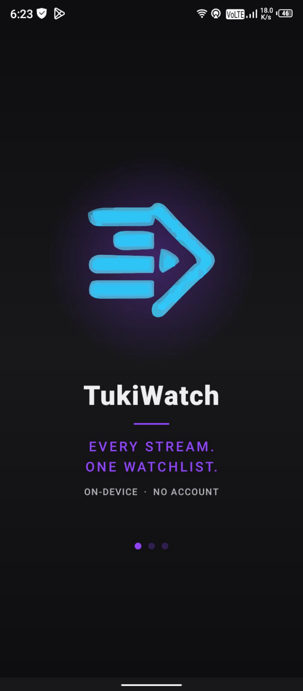
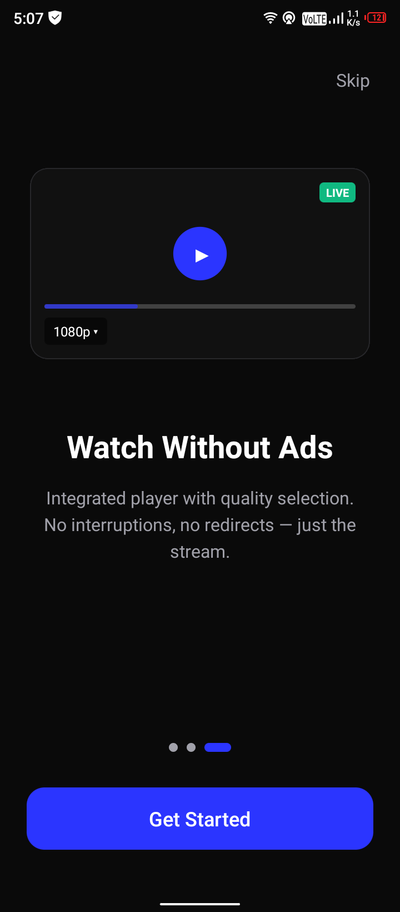
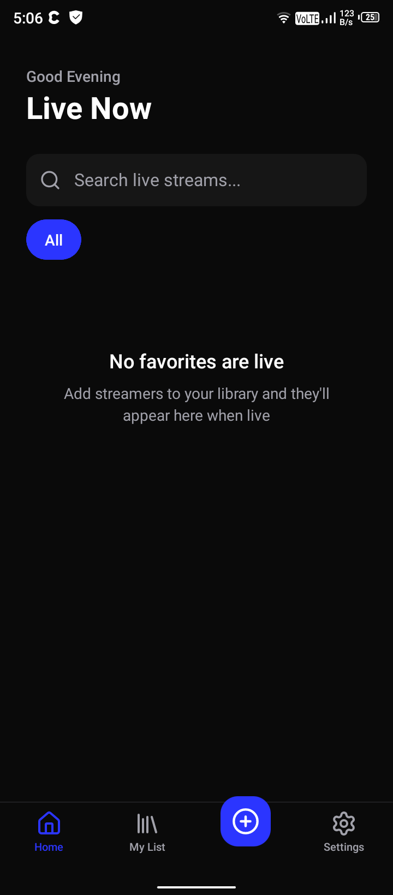
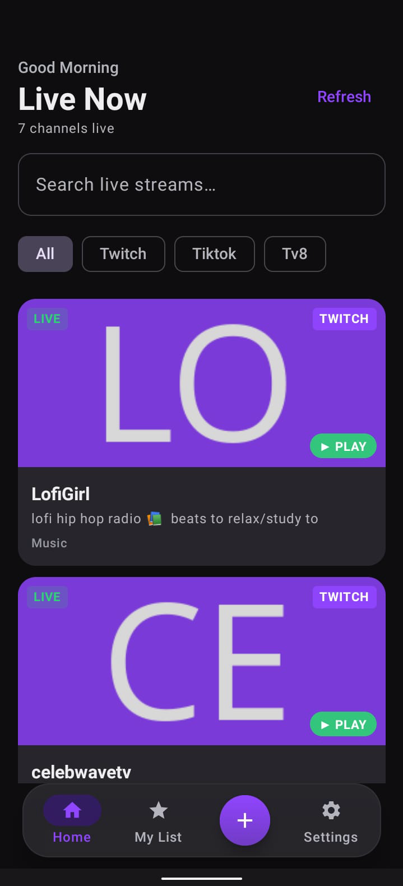
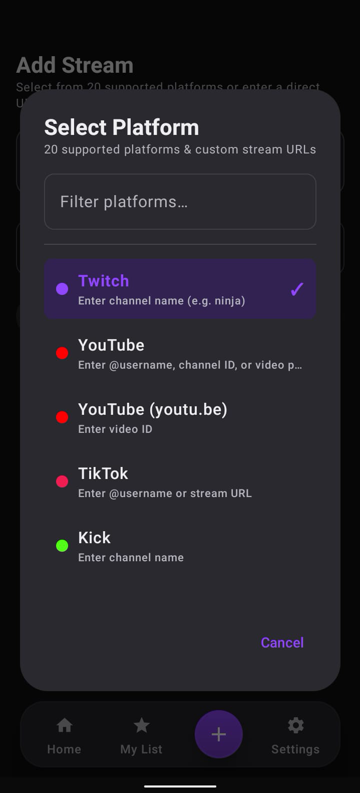
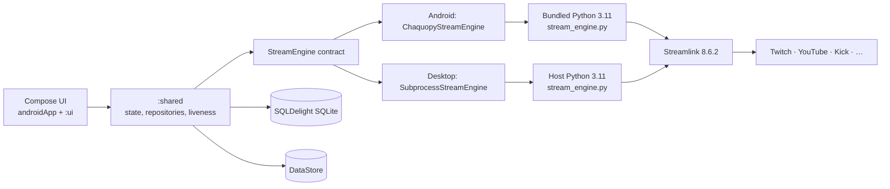

<div align="center">


# TukiWatch

**A privacy-first Android app for tracking and watching live streams — with Streamlink running on-device inside the APK.**

[](LICENSE)
[](https://github.com/snowballons/tukiwatch)

[Releases](https://github.com/snowballons/tukiwatch/releases) · [Website](https://tukiwatch.snowballons.com/) · [Contributing](CONTRIBUTING.md)

</div>

---

## About

TukiWatch keeps your favourite live streams in one Android app. Favourites,
settings, and stream resolution all stay on the device: there is **no backend
service**, no account system, and no cloud sync.

Stream resolution uses [Streamlink](https://streamlink.github.io/) running inside
the APK through [Chaquopy](https://chaquo.com/chaquopy/), embedded in a Kotlin
Multiplatform + Compose application. The same shared UI and state layer also
powers a desktop harness used for development.

---

## Features

- **Live Now** — a Home screen that shows which saved channels are currently
  online, with search and platform filters.
- **My List** — search, filter, add, and remove favourites; every entry keeps its
  last known live state.
- **Add streams** — choose from 20 preset platforms (Twitch, YouTube, TikTok,
  Kick, Facebook, Instagram, and more) or enter a direct URL, preview-resolve it
  on-device, then save or play it.
- **In-app player** — Media3 ExoPlayer with quality selection, fullscreen,
  picture-in-picture, and an “open in official app” action.
- **Local-first data** — favourites live in SQLDelight/SQLite; preferences live
  in DataStore. JSON export/import is available for backups and migration.
- **Foreground liveness** — saved channels are refreshed while the app is in the
  foreground; network failures are surfaced without treating them as plugin
  errors.
- **Share and deep links** — accepts shared stream URLs and
  `tukiwatch://` links.
- **Theme, onboarding, and legal screens** — System / Light / Dark appearance,
  first-run onboarding, and in-app privacy/terms pages.

### Screenshots

| Onboarding | Onboarding | Home (empty) | Home (live) | Add stream |
|:----------:|:----------:|:------------:|:-----------:|:----------:|
|  |  |  |  |  |

---

## Non-goals

- **No backend or server component.** Stream resolution happens on-device.
- **No accounts, cloud sync, or analytics.** Favourites and settings are local.
- **Android only.** There is no iOS or web client.
- **Not a general-purpose media player.** TukiWatch tracks and plays live
  streams; it is not a streaming platform.

---

## Tech stack

| Area | Technology |
|---|---|
| App | Kotlin 2.4.20 · Compose Multiplatform 1.12.1 · Material 3 |
| Android | AGP 9.1.1 · Gradle 9.5.1 · JDK 21 toolchain · minSdk 26 / targetSdk 37 |
| Engine | Chaquopy 17.0.0 · Python 3.11 · Streamlink 8.6.2 |
| Playback | AndroidX Media3 / ExoPlayer 1.11.1 |
| Data | SQLDelight 2.4.1 · DataStore 1.3.0 · kotlinx.serialization |
| Build | Gradle wrapper in [`app/`](app/) |
| Release | GitHub Actions, manual APK workflow |

---

## Architecture



- **`:shared`** — headless core: engine contract, SQLDelight favourites, JSON
  backup, DataStore preferences, liveness, and network-error classification.
- **`:ui`** — shared Compose screens and plain state controllers.
- **`:androidApp`** — the shipped APK: Compose host, Chaquopy bridge, Media3
  player, SAF pickers, and the bundled Python engine.
- **`:desktopApp`** — JVM harness that renders the same UI against a host Python
  interpreter. Not shipped.

See [`app/README.md`](app/README.md) for the module-level details.

---

## Repository layout

```text
tukiwatch/
├── app/
│   ├── androidApp/   # Android APK, Compose host, Chaquopy, Media3
│   ├── shared/       # engine contract, SQLDelight, DataStore, liveness
│   ├── ui/           # shared Compose screens and state controllers
│   └── desktopApp/   # JVM development harness (not shipped)
├── web/              # static landing / legal site, deployed separately
├── assets/           # README screenshots and brand assets
├── .github/          # release workflow
├── AGENTS.md         # instructions for coding agents
├── CONTRIBUTING.md   # contributor setup and quality gates
├── CHANGELOG.md
└── LICENSE
```

---

## Getting started

### Prerequisites

- **JDK 21** (Gradle toolchain)
- **Android SDK 37** with platform tools; set `ANDROID_HOME` or create
  `app/local.properties` with `sdk.dir=...`
- **Python 3.11** on the build machine for Chaquopy
- **Streamlink 8.6.2** in that Python 3.11 environment only if you want to run
  the host-side Python parity tests

No JavaScript build toolchain is required to build the app.

### Build the APK

```bash
git clone https://github.com/snowballons/tukiwatch.git
cd tukiwatch/app

./gradlew :androidApp:assembleDebug
# APK: androidApp/build/outputs/apk/debug/androidApp-debug.apk
```

If `python3` on your `PATH` is not Python 3.11, point Chaquopy at the right
interpreter:

```bash
./gradlew :androidApp:assembleDebug \
  -Pchaquopy.buildPython=/path/to/python3.11
```

### Run the desktop harness

```bash
cd app
./gradlew :desktopApp:run
```

The harness uses a host Python interpreter and the same
`androidApp/src/main/python/stream_engine.py` as the APK. It is a development
tool, not a shipped target.

---

## Testing

```bash
cd app

# Shared data/engine and UI state
./gradlew :shared:jvmTest :ui:jvmTest

# Android host tests
./gradlew :shared:testAndroidHostTest

# Desktop harness tests (Compose UI tests need a display)
xvfb-run -a ./gradlew :desktopApp:test

# Python engine parity (Python 3.11 + streamlink 8.6.2)
python3.11 -m pytest androidApp/src/main/python/test_stream_engine.py
```

The desktop UI tests open a real Compose window; on a machine without a display,
run them under `xvfb-run` or skip them. The Python test path is relative to
`app/`.

---

## Releasing

The Android version is declared in
[`app/androidApp/build.gradle.kts`](app/androidApp/build.gradle.kts) — currently
`1.1.5` (`versionCode 13`).

Releases are built manually with
[`.github/workflows/release-android.yml`](.github/workflows/release-android.yml):

- `./gradlew :androidApp:assembleRelease`
- optional production signing via repository secrets
- APK attached to a GitHub Release when a version is supplied

Keep the Gradle `versionName`/`versionCode` and the release tag in sync.

---

## Website

[`web/`](web/) contains the static landing page and legal pages. It is deployed
separately from the APK and is not part of the Android build.

---

## Privacy and security

- Favourites and settings stay on-device.
- There is no TukiWatch backend, account, or analytics service.
- Stream resolution and playback make network requests directly to the relevant
  third-party platforms and their CDNs.
- No API secrets are bundled in the APK. Any optional platform credentials are
  supplied by the user and stored locally.
- To report a vulnerability, email **tukiwatch@snowballons.com** — please do not
  open a public issue for security bugs.

---

## Contributing

Contributions are welcome. Start with [`CONTRIBUTING.md`](CONTRIBUTING.md) and
the repository’s [`AGENTS.md`](AGENTS.md), then open an issue or pull request.

---

## License

This project is licensed under the [MIT License](LICENSE) (SPDX: MIT) —
Copyright (c) 2026 Snowballons.
